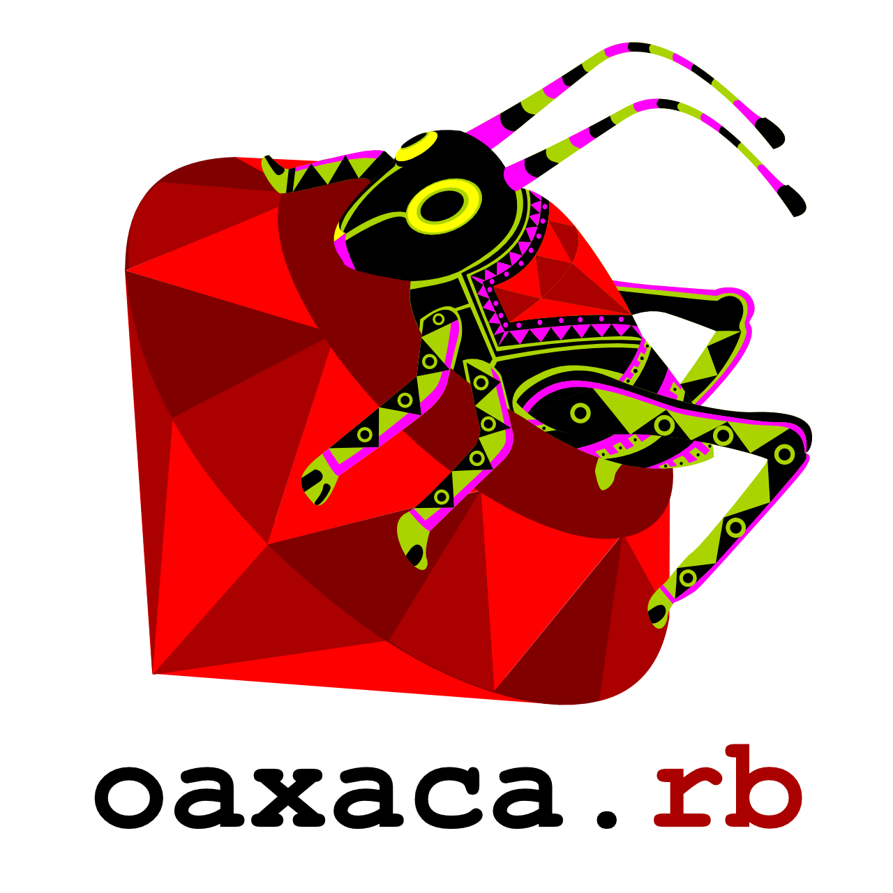

<section class="max-w-6xl mx-auto px-4 sm:px-6 lg:px-8 pt-12 md:pt-16 pb-6">
  <h1 class="font-display text-[44px] sm:text-[60px] md:text-[72px] text-anil leading-[0.95]">Agradecimientos</h1>
  

    Oaxacoders no sería lo que es sin el apoyo de personas y organizaciones que han creído en la comunidad. En este espacio expresamos nuestro agradecimiento a quienes han puesto su granito de arena — o su granito de código.
  

</section>



<section class="max-w-6xl mx-auto px-4 sm:px-6 lg:px-8 py-12 md:py-16">
  

    <!-- oaxaca.rb -->
    <article class="bg-white rounded-[12px] p-6 border-2 border-transparent hover:border-anil transition">
      

        
      

      <h3 class="text-[22px] font-extrabold text-anil leading-tight mb-3">
        <a href="https://oaxacarb.org/" target="_blank" rel="noopener" class="underline decoration-rosa decoration-2 underline-offset-4 hover:text-rosa transition">oaxaca.rb</a>
      </h3>
      

        A los fundadores y miembros de oaxaca.rb, por sentar las bases y ser la inspiración de esta comunidad. Cinco años organizando eventos no es poca cosa, y ese esfuerzo constante es lo que nos motivó a seguir construyendo.
      

    </article>

    <!-- Emmanuel -->
    <article class="bg-white rounded-[12px] p-6 border-2 border-transparent hover:border-anil transition">
      

        
      

      <h3 class="text-[22px] font-extrabold text-anil leading-tight mb-3">
        <a href="https://www.linkedin.com/in/emmanuel-mendoza-acevedo" target="_blank" rel="noopener" class="underline decoration-rosa decoration-2 underline-offset-4 hover:text-rosa transition">Emmanuel Mendoza</a>
      </h3>
      

        Participó activamente en oaxaca.rb y en esta nueva etapa nos abrió las puertas de un espacio céntrico para recibir a ponentes internacionales. Gracias por facilitar que las ideas fluyan.
      

    </article>

    <!-- Atzomx -->
    <article class="bg-white rounded-[12px] p-6 border-2 border-transparent hover:border-anil transition">
      

        
      

      <h3 class="text-[22px] font-extrabold text-anil leading-tight mb-3">
        <a href="https://atzomx.com.mx/" target="_blank" rel="noopener" class="underline decoration-rosa decoration-2 underline-offset-4 hover:text-rosa transition">Atzomx</a>
      </h3>
      

        A Atzomx Café y Coworking, por ponernos a disposición sus excelentes instalaciones para la realización de nuestros eventos. Un buen espacio hace toda la diferencia, y el suyo la ha hecho.
      

    </article>

    <!-- IIAB -->
    <article class="bg-white rounded-[12px] p-6 border-2 border-transparent hover:border-anil transition md:col-span-2 lg:col-span-1">
      

        
      

      <h3 class="text-[22px] font-extrabold text-anil leading-tight mb-3">
        <a href="https://internet-in-a-box.org/" target="_blank" rel="noopener" class="underline decoration-rosa decoration-2 underline-offset-4 hover:text-rosa transition">Internet-in-a-Box</a>
      </h3>
      

        A nuestros amigos de Internet-in-a-Box por su amistad, apoyo a la comunidad y con el contacto para las charlas con ponentes internacionales. Gracias a
        <a href="https://www.linkedin.com/in/avnikhatri/" target="_blank" rel="noopener" class="font-bold text-anil underline decoration-rosa decoration-2 underline-offset-2 hover:text-rosa transition">Avni</a>,
        <a href="https://unleashkids.org/" target="_blank" rel="noopener" class="font-bold text-anil underline decoration-rosa decoration-2 underline-offset-2 hover:text-rosa transition">Adam</a>,
        <a href="https://www.codewiz.org/" target="_blank" rel="noopener" class="font-bold text-anil underline decoration-rosa decoration-2 underline-offset-2 hover:text-rosa transition">Bernie</a>,
        <a href="https://quidam.cc/" target="_blank" rel="noopener" class="font-bold text-anil underline decoration-rosa decoration-2 underline-offset-2 hover:text-rosa transition">Rubén</a>
        y <a href="https://ark.switnet.org/acerca/" target="_blank" rel="noopener" class="font-bold text-anil underline decoration-rosa decoration-2 underline-offset-2 hover:text-rosa transition">Luis</a>.
      

    </article>

    <!-- Ponentes (ancho completo) -->
    <article class="bg-white rounded-[12px] p-6 border-2 border-transparent hover:border-anil transition md:col-span-2 lg:col-span-3">
      

        

          <svg class="w-8 h-8 text-anil" fill="none" stroke="currentColor" viewBox="0 0 24 24">
            <path stroke-linecap="round" stroke-linejoin="round" stroke-width="2" d="M19 11a7 7 0 01-7 7m0 0a7 7 0 01-7-7m7 7v4m0 0H8m4 0h4m-4-8a3 3 0 01-3-3V5a3 3 0 116 0v6a3 3 0 01-3 3z"/>
          </svg>
        

        

          <h3 class="text-[22px] font-extrabold text-anil leading-tight mb-3">
            <a href="/eventos/todos/" class="underline decoration-rosa decoration-2 underline-offset-4 hover:text-rosa transition">Ponentes</a>
          </h3>
          

            A todas las personas que han compartido su conocimiento y experiencia en nuestros eventos. Cada charla enriquece a la comunidad y nos inspira a seguir aprendiendo.
          

        

      

    </article>

  

</section>
